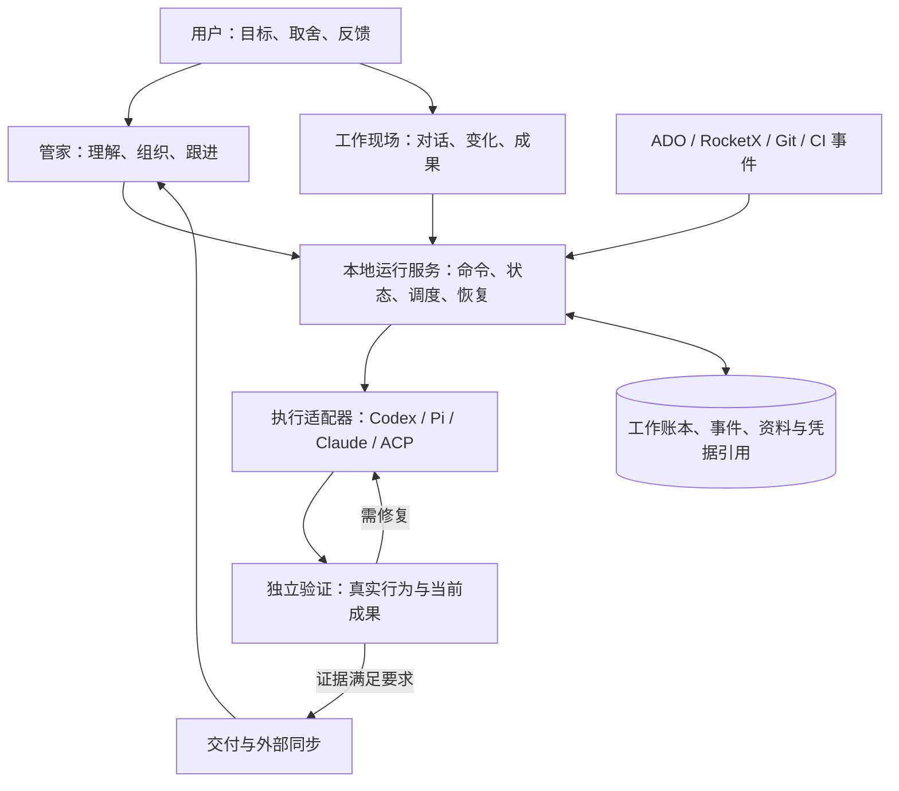

# RocketX 自主工作系统完整方案

版本：1.1。状态：首版目标方案，按切片实施与验证；不表示已交付。日期：2026-11-17。

本文承接长期管家与执行 Agent 分离的方向，并吸收真实使用暴露的入口、控制、反馈和验收问题。2026-11-17 用户进一步确认：能直接控制多项工作时，以可操作的 Kanban 为主界面，管家提供顶部简报与按需对话；一项工作仍在同一现场内继续。后续目标设计以本文为主；当前行为仍以代码及真实验证为准，旧实现证据保留在[实施记录](implementation-notes-rocketx-agent-workspace-refactor.md)。

配套执行文件：[WBS 计划](rocketx-autonomous-workspace-wbs.md)。方案负责范围、行为和架构；WBS 负责工作包、依赖、职责与证据。旧[重构方案](rocketx-agent-workspace-refactor-plan.md)只作背景，不另行驱动一套进度。范围变更同时更新这两份文件。

阅读路径：产品与交互读第 1–6 节，工程与工具链读第 7–14 节，交付负责人读第 15–18 节及 WBS。第 18 节提供稳定需求 ID 和验收条目，用于追踪实现，不以易变行号建立验收关系。

## 0. 首版交付范围

| 分类 | 范围与完成边界 |
| --- | --- |
| 必须交付 | Windows 本机；Pi 管家及已有模型配置；Codex 原生持续控制与原会话恢复；同页工作现场和可信总结；持久工作/命令/事件；本机有界并行；Bug 自主调查修复；ADO 与 GitHub；独立验证、授权内 PR/合并及 RocketX 汇报；迁移、恢复、诊断和可安装候选 |
| 按能力实测开放 | 连接正在运行的 Codex 原桌面实例；特定提供方的即时调整和原端停止；按项目启用的自动发布。每项有独立通过证据；缺失时报告能力缺口，不允许以同 ID 恢复替代 attachLive 的验收 |
| 保持已有能力、随后增强 | Claude/其他 ACP/Antigravity 的现有连接与记录不得回归；新增完整持续控制按提供方单独验收，首版不宣称所有执行者等价；长期记忆高级检索与流程复用后续增强 |
| 可选独立包 | 本地语音识别和播报；核心文本旅程不依赖它，也不要求显卡或云端语音 |
| 首版排除 | 虚拟机、远程执行池、多节点调度、手机远程控制、公共 webhook 托管服务、完整企业治理、通用流程设计器、新建技能市场 |

首版后台的最低完整承诺：关闭或重建 WebView 后，应用后台仍持续跟进；完全退出应用、睡眠或关机后，持久记录在重新启动时核对恢复。独立于整个桌面应用退出后仍运行的常驻 Host 是本机增强包，不阻断此最低承诺，但其验证未通过前不得显示“退出后继续工作”。

首版本机调度建议总执行槽上限为 2，并在受测机器上确认；构建/打包等重任务默认串行，执行与独立验证共用资源预算。三项并行验收指三项工作能够独立推进及等待调度，不要求三个重进程同时运行。资源默认值是设计候选，须根据冷/热启动与持续运行测量调整。

## 1. 产品主旨与边界

**让用户用少量注意力，持续推进多项工作，并得到可以检查和使用的成果。**

用户承担目标、优先级、业务取舍和授权。管家承担理解、组织、委派、跟进、协调验证、返工和交付。用户随时可以进入具体工作直接指导，不需要自己选择会话 ID、传递子 Agent 消息或检查调度器。

### 已确认的约束

- Windows 本地优先；已有 Tauri、React、Rust、SQLite、Pi 能力优先复用。管家可沿用当前 DeepSeek 配置，执行者使用各自支持的模型和登录。
- 首版明确只支持本机执行，不支持虚拟机、远程执行池或多节点调度。相关设计保留为后续方向，不作为首版开发及验收门槛，也不预先部署节点注册、镜像管理或远程控制服务。
- 本地运行与模型推理位置分别说明：本地运行不代表所有推理离线。没有显卡不影响使用已配置的远程模型。
- 已有 Codex 工作是首个必须走通的控制旅程。历史发现、恢复历史、连接正在运行的实例分别验证。
- ADO 与 GitHub 并列作为工作来源、代码协作和验证通道，RocketX 承担消息及工作状态同步；语音可选，默认关闭，只研究本地语音方案。
- 新增工作与已有会话都能进入同一工作现场。普通问答不强制建卡，不要求先填验收表。
- 本次只完成设计；不安装依赖、不改变账号、不自动发送外部消息、不迁移用户数据库。

### 成功如何衡量

主要指标是每项已验收工作的人工耗时、交付周期、返工率、逃逸缺陷和总成本。PR 数、Agent 数、模型调用数只作诊断数据。先建立真实基线，再定吞吐目标；月度数千 PR 的案例不构成我们的容量承诺。

正确性不变量独立于平均指标：不得串会话或账号；不得因丢回执重复写入；未确认停止不得显示已停止；未满足当前要求不得显示已完成。发生一次即阻断该能力的验收。

## 2. 总体结构与职责

用户心智保持两层：长期管家和承接工作的执行者。下面的运行、资料、验证服务是基础设施，不是要求用户管理的新角色。



| 参与者 | 职责 | 约束 |
| --- | --- | --- |
| 用户 | 定目标、改变优先级、决定业务取舍 | 不承担轮询、搬运信息、选择内部 ID |
| 管家 | 判断意图、补齐关键上下文、组织工作、形成简报 | 提议通过明确工具执行；自然语言本身不能修改完成状态 |
| 工作负责人 | 维护单项工作的计划、执行与返工 | 简单工作由执行者兼任；不为每件小事再启动一层经理 |
| 执行者 | 在指定范围内产出代码、文档或其他成果 | 一次执行绑定明确目标版本、目录、身份和授权 |
| 验证者 | 按完成条件检查当前产物，提供可复查证据 | 与实现分开上下文；模型判断不能取代可执行检查 |
| 运行服务 | 持久化、排队、路由、限额、恢复、事件处理 | 确定性规则掌握写入和状态推进权，不依赖模型记住流程 |
| 集成与交付工具 | 跟进 CI、更新工作项、汇报及发布 | 只执行已有授权，绑定目标、内容和提交版本 |

“团队”按工作临时组合，先验证单负责人能完成的最小单元，再扩大并行。独立任务使用独立执行上下文；同一任务的返工沿用负责人。不会为展示团队感而长期保留空闲模型循环。

## 3. 贯穿设计的一项工作

示例：用户说“把 ADO 1842 的附件重复发送问题解决，沿用 Codex 里已经开始的那条工作，修好后同步进度”。这里的编号仅为设计样例。

| 阶段 | 用户体验 | 系统承担 | 可核对的事实 |
| --- | --- | --- | --- |
| 理解 | 输入后看到一句理解及关联工作 | 查授权范围内 ADO、已有会话、项目约束；唯一匹配自动关联 | 来源和身份明确，存在歧义才询问 |
| 接续 | 工作现场展示原对话，可继续说话 | 判断当前连接、原生恢复或仅历史；建立并验证通道 | 原 ID、账号、目录、当前执行轮次 |
| 执行 | 简短显示“正在复现”，可看变化 | 负责人复现、修改、记录成果；按依赖安排协作 | 实际执行事件和代码差异 |
| 中途改变 | 输入“先别提交，保留旧接口” | 定位当前工作及活动轮次，立即调整或明确排队；更新相关要求 | 接收方回执与生效范围 |
| 验证 | 显示“正在检查重复发送和断线重试” | 独立环境执行用户路径，失败退回负责人 | 运行记录、检查项、当前提交与结果 |
| 交付 | 直接看到修复说明、差异、演示和剩余项 | 在授权范围内跟进 PR/CI、同步 ADO、准备汇报 | 验收版本、合并/发布/消息送达各自回执 |
| 后续反馈 | 在成果旁说“这个边界再调整” | 沿同一工作返工，升级相关要求/成果版本 | 旧成果保留，新验证重新生成 |

用户离开时，不需要再说“继续”。遇到机器睡眠、登录失效、预算不足等实际约束，工作进入可解释的等待，恢复后先核对再推进。

## 4. 日常页面与信息层级

### 4.1 主导航

AI 工作区默认进入“我的工作”控制看板；管家简报在顶部，对话按需展开，不要求为控制工作先切进一条总对话。项目是筛选和上下文，不再维护平行任务列表。消息、日历、ADO 等既有业务入口保留，不叠加一列执行器导航。连接、模型、技能、例行任务管理放在设置或对应工作菜单。

主导航宽度建议 220–260 px，允许折叠。主区始终只有一个主要工作现场。成果/文件/差异需要时打开辅助区；日志默认折叠。小窗口辅助区覆盖主区并可原位返回，不同时把三列挤窄。

### 4.2 管家简报与对话

看板顶部提供简短变化摘要，回答哪些正在推进、哪里需要用户决定、哪些成果可看；对应动作直接定位卡片或打开同页成果。管家对话保留为交代新事、跨工作提问与总结的辅助入口。普通问候不生成空工作。空工作区先提供输入框和少量可编辑示例；后台探测连接，仅在执行所需能力缺失时就地引导。

首页回答三个问题：现在有什么值得知道？什么需要我决定？我可以交代什么？不展示安装清单、进程数、模型重试次数或长篇运行日志。

### 4.3 我的工作

默认是可操作的四列看板：“待开始、正在推进、需要你、结果待看”。等待外部响应显示在卡片的具体原因中，不另增一排过程阶段。卡片只保留工作标题、当前事实、必要的验证/阻塞说明、来源和主要动作；当前问题与可回答选项直接在卡片上出现。已交付历史收起；进入“结果待看”只说明已有结果可审阅，不等于已经通过验收。

开始、补充要求、停止、回答与审阅均由卡片直达。打开工作后同页展开对话/成果辅助区，宽窗口保持看板列和卡片位置；窄窗口自然堆叠，收起后恢复原位置。不同工作的草稿相互独立。状态来自真实执行投影：开始/停止未确认时保持原列并解释正在处理；拖动卡片不能直接写入执行或完成状态。更改业务优先级与改变执行状态分开表达。

只在事实足够时生成摘要；标题只是识别线索，不能据标题推断当前目标。历史来源明确写“上次记录……”，实时来源写“正在……”。不重复堆叠目标、摘要、下一步三个相同段落。

### 4.4 工作现场

```text
项目 / 工作标题                         当前情况 · 更多
最近变化：已复现重连后重复发送              查看改动
─────────────────────────────────────────────────────
连续工作对话：原上下文、你提出的要求、重要进展
就地的提问/必要批准卡片
可打开的成果：差异、文件、验证记录、外部链接

─────────────────────────────────────────────────────
发给：这项工作       [引用的文件/消息/改动片段]
[补充要求、提出修改，或回答上方的问题……           ]
              立即调整（有能力时，单次作用）      发送
```

主发送动作与 Enter 始终发送；执行中默认在本轮结束后处理补充，明确时机。“立即调整”是一次显式动作，不是残留的发送模式。工作现场的对话和执行日志分层呈现：用户要求、实际回答、决策与成果是主线；工具调用在同一时间位置折叠。可切换“成果”视图，但不能丢失输入框、当前目标和草稿。执行器管理不进入日常路径。

### 4.5 首用与连接

后台只探测必要元数据，不自动把所有历史加入工作列表。首次进入允许用户先提问。第一次委派时沿用已保存的可用配置；无可用执行者时就在输入附近显示“连接 Codex”等具体动作，成功后回到原草稿。

“查找已有工作”按项目、近期时间和内容预览展示真实会话，先验证能读取和怎样继续。用户选择后直接进入工作现场。来源、路径、模型参数属于“连接详情”；不要让用户填写会话 ID。

### 4.6 一眼理解、就地操作与管家总结

2026-11-17 用户补充：减少页面切换和无效信息；日常体验以“扫一眼能懂、主要操作点一下”为目标。管家与我的工作是同一工作系统的两个入口，不能要求用户来回跳转才能完成一项操作。

信息按三层展开：

1. **默认结论层**：一句当前结论，必要时补一条影响/待决定事项，加一个主要动作。正常推进且无需用户处理的工作可合并呈现；重要阻塞与未完成项不得因压缩而消失。
2. **就地工作层**：点击工作或摘要中的动作，原位展开对应对话、成果或决定；输入框、接收对象、草稿和阅读位置保留。回答、补充要求、暂停、重试、查看成果均可在这里完成。
3. **追溯层**：按需查看证据、工具记录、连接详情；最多打开一个辅助区，切换内容复用该区，禁止抽屉里再开抽屉。深链和浏览器返回仍需恢复到原工作和原位置。

管家总结应回答“现在怎样、对我有什么影响、下一步谁来做”。将多个执行者、重试和检查整理成工作级事实，不逐条复述日志，不增加一份需要用户阅读的长报告。

示例（设计样例，非当前真实工作状态）：

> 附件重复发送已修复，重连场景验证通过。还有一项旧接口兼容检查正在运行，暂时不需要你处理。〔查看改动〕

> 发布准备就绪，需要决定是否包含实验语音功能。建议本次不包含，以免影响发布时间。〔本次不包含〕〔调整范围〕

总结必须关联原始事件、成果版本、时间范围和更新时间。历史记录、原端未确认和执行状态未知必须保留语义，不能总结成实时确定事实；存在相互冲突的证据时说明冲突。没有新事实不反复改写同一段总结，不因措辞变化产生未读提醒。更新时不覆盖用户正在阅读或编辑的内容。

摘要中的动作直接绑定对应工作、问题和预期版本；执行前由后台重新校验现状。总结文本不能生成新的权限，旧摘要上的批准按钮不能批准新版本动作。需要审阅的动作在当前区域给齐对象、影响和选择，信息不够时原位展开；“点一下”不要求隐藏必要的决定。

日常动作路径：从总览直接回答决定或打开成果，不先进入详情页再寻找某个标签；点击工作行直接进入该工作的对话现场；成果批注立即进入同工作草稿；连接失败就地恢复。只有用户主动进入管理设置或打开原生外部工具时才离开主工作现场。

默认删除无决策价值的显示：重复目标/摘要/下一步、空计划、空成果区、内部 ID、常驻协议/模型/进程状态、多层状态徽章、没有变化的时间戳刷新。详细执行记录仍可追溯，空白信息不占首屏。

原型验收目标：初次看到一项工作，用户能在约 5 秒内说清现状、是否需要自己处理、下一步是什么；主要可直接执行动作一次点击完成，必要审阅最多一次原位展开；日常发送/回答/看成果/提修改不经过管理页；不同入口的同一动作结果一致。这些是待可用性测试验证的目标，不是已达指标。

## 5. 已有会话的三条路径

| 检测结果 | 主动作与体验 | 实现要求 |
| --- | --- | --- |
| 能连接当前运行实例 | 打开即订阅进展；输入直接指向该会话 | 可靠端点、账号和原生身份核验；所有控制共享同一原端状态 |
| 只能恢复已保存会话 | 空闲且控制归属已证实时自动准备恢复，下一条要求继续原工作 | 原生恢复接口；不能擅自复制成新会话；已恢复通道继续保持连接 |
| 只有历史记录 | 先显示记录与具体限制，提供“在原应用打开”；必要时单独提供带来源的新工作 | 不能伪造正在运行、可中断或可继续；新工作明确说明上下文范围 |

外部实例是否正在写入不能只靠文件修改时间或 PID 猜测。已证明支持共同控制的端点不要求用户先停止；没有可靠控制归属时，一次明确交接可作备用方案，不能作为所有工作的默认日常流程。

“新建运行时来恢复同一 ID”与“连接原桌面正在运行的实例”是不同能力。Codex Windows 当前安装版本能否共享原端控制通道，必须先做技术探针，不能由 App Server 文档或 T3 支持 Codex 推导为可行。

## 6. 输入、反馈与注意力的细节合同

| 情况 | 界面行为 | 系统合同 |
| --- | --- | --- |
| 点击发送 | 立即显示这条要求，保留正文 | 先持久化 requestId、目标身份和内容；入队不等于原端收到 |
| Enter / 中文输入法 | Enter 发送，Shift+Enter 换行；候选词确认不发送 | 使用 composition 状态；快捷键可统一设置 |
| 点击示例 | 填入草稿并聚焦 | 不自动派发 |
| 运行中输入 | 已验证支持时默认“立即调整”，否则显示“排队发送”；可显式切换并记住偏好 | 发送前可预知生效时机；不能用停止再重启冒充 steer |
| 编辑排队消息 | 原位修改或撤回；保留当前草稿 | 仅未派发消息可编辑；执行中的要求通过后续消息修正 |
| 要求已收到 | 一个简短回执 | 依据原端接收事实，不用本地 optimistic running 代替 |
| 要求生效不确定 | 显示“正在核对是否收到” | 不自动重发可能产生副作用的内容 |
| 切换工作 | 当前草稿、附件、阅读位置自动保存 | 请求绑定点击发送时的目标，不读取全局当前选中项 |
| 返回工作 | 返回离开时位置；顶部提示新增重要变化 | 看旧消息时不自动滚底；提供“回到最新” |
| 提问 | 原工作中显示短问题、建议选项和影响 | 能从资料或工具查询到的事实由系统先查；答案绑定该问题版本 |
| 必要批准 | 说明动作、对象、影响与批准范围 | 不把“查看”“展开”“继续阅读”做成授权 |
| 通知 | 同一问题聚合一次；可稍后处理 | 仅新阻塞、重要成果、需决策或约定时间触发；无变化静默 |
| 从通知进入 | 直达具体问题/成果 | 过期批准显示已失效，不误操作当前轮次 |
| 稍后处理 | 收起提醒并说明工作当前状态 | 不等于暂停；阻塞分支等待，独立分支可继续 |
| 暂停 | 显示“正在暂停”，随后展示实际停止范围 | 停止后续派发，向相关运行请求中断，等回执；不可中断动作单列 |
| 停止一个执行者 | 不误停止整项工作或其他任务 | 操作带 runId 和范围；暂停整个目标是独立动作 |
| 取消工作 | 保留成果和记录，停止后续推进 | 撤销未派发动作，逐项核对在途动作；不承诺撤回外部已发生写入 |
| 修改目标 | 简短展示影响，如“需重跑两项验证” | 更新 requirementsVersion；仅受影响部分失效，不盲目重做全部 |
| 查看成果 | 原位预览/差异，支持引用具体部分提意见 | 反馈指向 artifactId 和版本，不仅截取易丢失的屏幕文字 |
| 页面关闭 | 工作继续，草稿保留 | 由后台持有运行；关闭辅助面板不取消任务 |
| 完全退出/睡眠 | 提前说明运行边界，恢复后原位呈现 | 本机睡眠/关机不能执行；持久化等待，不编造后台进度 |
| 连接失败 | 输入附近给具体原因和恢复动作 | 不跳到空配置页；保留目标、文本与附件 |
| 搜索 | 按标题、对话、工作项和成果搜索 | 标明来源和更新时间；严格按账号/可见范围过滤 |
| 操作忙碌 | 同一动作防重复，其他工作可用 | 不用全屏 spinner 阻塞全部工作 |
| 键盘/读屏 | 焦点可见、Escape 退出当前层、返回恢复焦点 | 状态文字不只靠颜色；变化播报节制；遵循减少动态效果偏好 |
| 语音 | 可选输入方式，识别文本先进入草稿 | 不改变发送/批准边界；关闭后停止录音和播放 |

建议体验预算（待测量，不是已达指标）：本地输入反馈在 100 ms 内；连接耗时超过 2 s 给出阶段说明；读取历史按需分页；大日志不挤占对话渲染。性能验收报告机器、数据量、冷/热启动和 p95，不只报最好的一次。

以下细节纳入同一验收：发送按钮只对应当前工作，管家总入口显示当前引用对象；模型或执行者变化时草稿保留且收件对象可见；多处同时编辑同一草稿时提示冲突；附件上传完成前允许继续编辑，失败可单独重试；撤销只覆盖尚未派发的操作。归来简报按上次已读游标生成，读过简报不等于接受成果或批准动作。归档保留结果与来源，删除记录和取消执行分别处理。

“先别提交”等限制要成为该工作的约束变更，并传给受影响执行者；正在发生的动作只能请求中断并说明结果，不能事后声称限制已经阻止了已完成写入。约束变更超过当前提供方 steer 能力时，原位说明等待或暂停选择。

## 7. 工作、执行、控制与完成的模型

沿用现有工作 ID，避免增加第二套待办系统。基础对象如下；能通过现有表扩展表达的，不为了概念完整而新增表。

| 对象 | 保存的事实 |
| --- | --- |
| Work | 用户目标、完成条件、范围、来源、负责人、优先级、要求版本与预算 |
| Task | 必要时拆出的可独立验收单元及依赖；简单 Work 可只有一个 Task |
| Run | 一次实际尝试、执行者、输入快照、开始/结束事实和结果 |
| SessionBinding | 原生会话身份、数据来源、账号、设备、配置、目录、协议和实测能力 |
| Command | 用户/管家的操作意图、稳定 requestId、原端关联和投递状态 |
| Decision | 真正待用户处理的问题、选项、有效版本、截止时间及答案 |
| Artifact / Evidence | 成果版本与验证记录；绑定要求、提交、构建及实际检查范围 |
| ExternalAction | 外部写入的冻结目标、内容、幂等身份、尝试与回执 |

四个维度分别保存：工作阶段（整理/执行/验证/交付/完成/取消）、执行状态（准备/运行/等待/中断/失败）、连接状态（连接中/在线/失联）、注意状态（无需处理/有变化/需决定）。用户界面只展示当前最重要的情况，不把所有状态字段排成标签墙。

工作完成由可执行的完成条件决定。“做出文件”“验证通过”“PR 合并”“发布可用”可能是不同目标；创建工作时由管家形成简短完成条件供用户纠正，不能默认为每件工作都要发布。外部汇报是否必需也属于完成条件，未送达时保留待交付。

## 8. 命令、事件和恢复

设计命令包括：提交要求、调整活动轮次、排队、回答问题、批准具体动作、暂停目标、停止某轮、恢复、归档。使用 provider-native 能力适配，不假设所有执行者支持同一组操作。

```text
界面/管家提交意图
→ 校验账号、绑定身份、授权、预期版本
→ 同一事务持久化命令及 outbox
→ 调度器认领并记录 attemptId
→ 适配器调用原端
→ 保存接收/执行/结果事件及原生标识
→ 推进工作投影、决定下一步和通知
```

命令状态至少区分 prepared、sending、accepted、completed、failed、unknown。accepted 仅代表接收。原端没有 requestId 查询时，可能发送成功但丢失回执的命令只能 unknown，先核对或请求人工判断；不承诺跨系统 exactly-once。

事件携带 accountScope、workId、runId、requestId、nativeThreadId/nativeTurnId、sequence、source、occurredAt/receivedAt。模型摘要是派生信息，不能覆盖原端事实。迟到事件按关联版本处理，不把旧轮次的完成推进到新要求。

恢复顺序：打开账本 → 获取宿主控制权并冻结新派发 → 枚举未决命令与资源占用 → 建立只读恢复连接、读取快照和可用事件 → 对账命令与旧运行 → 更新投影 → 仅对已证实可用的资源恢复派发。事件断档时读取快照，不猜测漏掉的动作。宿主租约接管不自动释放仍可能运行的工作区租约。租约带 generation/fencing token，旧宿主不能继续写入；该机制只约束我们管理的写入者，不虚构对外部实例的锁。

## 9. 后台运行与进程架构

### 9.1 建议方案

保留 Tauri 桌面壳及 Rust 账本基础，提取不依赖 WebView 的 Runtime Host。目标为独立本地进程、当前用户权限运行，由桌面启动/发现并可在关闭窗口后继续。进程管理、SQLite 事务、凭据引用、命令/outbox、租约和事件队列归 Runtime Host；Node 作为已管理的 Pi/SDK/协议适配子进程。

首个技术探针需验证现有 Rust 模块脱离 `AppHandle` 的最小代价。可暂时由 Tauri 主进程运行同一个核心，但必须明确仅覆盖关闭窗口；在独立 Host 验收前不能宣称退出应用仍工作。最终不得保留前端和后台两套同时生效的调度。

Windows 首选带当前用户 ACL 的本地命名管道；跨平台后续使用权限受限的 Unix socket。Tauri IPC 是 UI 入口，后端转发给 Host。协议有版本、启动握手、身份、请求与事件游标；不开放无认证的局域网控制端口。具体 IPC 库选型在探针后确定，本设计不安装新依赖。

### 9.2 职责迁移

| 当前基础 | 目标处理 |
| --- | --- |
| `butler_ledger.rs`、`butler_db.rs`、账号隔离 | 复用持久事实、版本与 CAS；由 Host 唯一写入 |
| `workCoordinator.ts` 的判定规则 | 作为领域合同和测试样例；迁移到后端后同一切片移除前端执行权 |
| `workSupervisor.ts`、`superAgentBridge.ts` 的页面内计时与队列 | 迁往 Host 的事件/计时调度；WebView 仅订阅 |
| `AppServerController.ts` | 复用协议概念与已验证解析；默认 Pi transport 不能冒充 Codex 原生连接 |
| `acp.rs`、`pi.rs` 与 bridge 子进程 | 复用进程生命周期；逐提供方核实持续控制，收缩一次性桥接的能力承诺 |
| Zustand 与 localStorage | UI 投影、筛选、草稿缓存；不持有完成权、唯一租约或调度真相 |
| 现有 worktree、外部动作、CI 证据模块 | 逐一接入同一命令/事件路径，保留实际作用域与版本校验 |

退出语义：关闭窗口保留后台；托盘“暂停并退出”先停止新派发并核对当前运行；“退出界面，继续工作”仅在独立 Host 就绪时出现。系统登录启动为用户可控设置，未开启时不开机偷偷启动。离线不触发网络重试风暴。

### 9.3 存储与版本

沿用按账号隔离的 SQLite（WAL 和事务策略需压测），以快照表＋有界事件日志＋outbox 满足重连；不引入完整事件溯源平台。大文件、录屏、原始日志按工作/运行归档为文件并存 hash 引用，数据库不塞大块媒体。

schema 迁移保存版本、迁移记录和恢复备份；先迁数据再切唯一写入者。新旧 Host 不同时写库；协议不兼容时给出明确升级/恢复路径。清理空间前保留未完成工作、待投递动作和仍被成果引用的证据。

### 9.4 后续版本：虚拟机与远程执行节点

本节仅描述后续扩展方向。首版全部在本机执行，以独立工作树、任务目录和进程管理支持适度并行；工作树提供文件隔离，不等同虚拟机的安全边界。构建、浏览器验收等重任务根据本机资源排队，等待 CI 或用户决定时释放可安全释放的执行资源，空闲时不维持无效 Agent 循环。

后续引入执行池时，产品仍使用同一套工作现场，调度器按能力和数据范围选择配置过的宿主。用户可以把任务固定在某个环境，或允许系统自动选择。VM 隔离提升并行安全性，但同一物理机器上的多个 VM 仍分享 CPU、内存和磁盘；模型限额、CI 与集成能力也限制总吞吐，不承诺线性扩展。

| 位置 | 适合的任务 | 选择依据 |
| --- | --- | --- |
| 用户本机 | 接续现有会话、检查本机环境/设备、需要当前本地资料的调查 | 数据与运行实例在本机；用户交互优先，不抢占全部资源 |
| 隔离 Windows VM | Windows 桌面复现、独立构建、具有交互桌面的自动验收 | 匹配操作系统、构建和驱动；需要可自动准备的测试账号与环境 |
| Linux VM/其他已配置宿主 | 后端、脚本、独立测试、适用平台的批量修复 | 工具链与任务匹配；不能替代 Windows 特有问题验证 |
| 独立验证节点 | 对指定提交重新安装、启动、测试 | 独立 checkout/测试数据；不依赖作者节点中未提交的状态 |

逻辑上分为一个工作控制服务和多个执行节点。控制服务持有权威任务状态、准入、调度、租约、预算、外部写入与最终证据索引；节点持有被分配的工作区、原生执行连接、局部事件缓冲和可恢复检查点。每个工作只有一个权威控制服务，不能让桌面、VM 和云端各自产生一份“最新状态”。

单机时控制服务可以就是本地 Runtime Host；需要在用户电脑离线后仍推进远程任务时，把控制服务部署到持续在线宿主。仅把执行者搬到 VM、控制服务仍依赖会休眠的电脑，不构成全天自主系统。迁移控制服务必须排空/对账并转交唯一控制权；桌面随后作为客户端连接。首阶段仍可由一个服务独占 SQLite；禁止多个节点通过共享盘直接写同一数据库。高可用或多调度器需求成立后，才单独评估服务端数据库与协调设施。

节点注册只报告能力与资源：nodeId、OS/架构、执行器及版本、工具链、可用并发、可用内存/磁盘、网络可达性、资料访问范围和当前健康。调度优先检查数据和授权边界，再检查原生会话归属、平台依赖、空闲资源与成本。临时验证可分发到其他节点；已有原生会话不能只复制一个 ID 就跨机器继续，必须具备提供方支持的迁移能力或明确新上下文路径。

任务派发包固定 repo/commit、要求版本、执行身份、环境模板版本、完成条件、输入引用、可修改范围、预算、命令 ID 和租约 generation。节点使用自己的隔离 checkout、测试账号与数据；不得克隆用户正在使用的工作目录和整套登录配置。凭据通过限定范围的引用/短期授权提供，不能打进 VM 镜像或写入提示词。成果以提交、补丁、文件和证据清单回传并核对 hash。

节点以认证加密通道向控制服务注册、领任务和上报事件；不把单机命名管道或未认证的本地控制接口直接暴露到网络。租约过期时节点停止接收新任务并尽力暂停当前执行；控制服务将运行标为失联/待核对。必须确认旧执行已结束或隔离其发布/写入能力后才能重新分派；无法可靠中断的提供方，失联后不能自动启动第二个可能冲突的执行者。对外部副作用仍使用唯一 outbox 与回执核对，不能声称租约解决了所有跨系统重复写入。

允许同一问题并行做独立调查或候选修复，但最终只选一个负责人提交合并结果。合并/发布按目标分支和环境排队；VM 关闭、崩溃、网络分区后必须回收或隔离残留进程与资源，再接新任务。

## 10. 执行器和工具链选择

> 首版范围已确定为本机执行。第 9.4 节的虚拟机与分布式执行留待后续版本；首版只保持清楚的执行适配边界，不提前建设分布式基础设施。

以下为本项目建议，不是所有提供方均已验证。

| 层 | 选择 | 依据及待验内容 |
| --- | --- | --- |
| 界面 | 现有 React、TypeScript、Vite、语义样式、Zustand | 不重写框架；重做工作现场与状态来源 |
| 桌面/运行宿主 | Tauri 2 / Rust / Tokio | 复用本地能力和进程管理；独立 Host 提取需探针 |
| 账本 | 现有 rusqlite / SQLite | 唯一写入与事务 outbox；验证崩溃、锁竞争和恢复 |
| 管家 | 现有 Pi 运行时和已配置 DeepSeek 等模型 | 仅通过受控业务工具行动；不用 Pi 恢复外部 Codex ID |
| Codex 执行 | 原生 `codex app-server` 持续连接 | 验证 list/read/resume/start/steer/interrupt、审批、事件、断线；测试支持版本范围 |
| Claude 执行 | 官方 Agent SDK 或提供方实际支持的 ACP | 保留会话与配置；原终端 Remote Control 不等于第三方自动接管接口 |
| Antigravity / 其他 Agent | 优先官方 CLI/ACP | 现有桌面 agentapi/hub 连接仅兼容通路，不作为跨版本可靠控制基础 |
| 扩展工具 | MCP 和现有业务桥接 | MCP 是工具访问，不天然具备会话控制或持久调度 |
| 隔离 | Git worktree＋明确目录写入归属 | 非 Git 工作使用独立任务目录；共享数据库/浏览器/服务另设锁 |
| CI/PR | 仓库既有 CI、ADO/GitHub API或CLI | 持续跟进实际回执；不增建第二个 CI 产品 |
| 前端验证 | 现有 Playwright | DOM/交互与浏览器合同；不代替 Windows 原生验证 |
| 桌面验证 | Tauri WebDriver / 匹配 WebView2 的驱动，现有 native smoke | 官方支持 Windows；驱动版本、隔离账号及完整流程需验证 |
| 回归/协议 | 现有 tsx 测试、Rust tests、生成协议 schema | 复用现有测试命令，建立真实提供方兼容矩阵 |
| 凭据 | 现有系统 keyring | 模型、UI和普通日志只拿引用或状态；不复制登录密钥到会话 |
| 本地语音 | 既有本地路径，后续评估 CPU ASR/TTS | 识别/响应延迟单独实测；不承诺无显卡达到云端实时语音质量 |

单机阶段不引入 Redis、Kafka、Kubernetes 或分布式工作流平台。首先用已有 SQLite、进程宿主与明确协议完成持久执行；只有真实规模证明瓶颈后才替换组件。

### 能力握手

每份连接绑定提供方、安装版本、配置身份与实测结果，分别声明 readHistory、resumeSaved、attachLive、send、steer、interrupt、approve、readArtifacts、replayEvents。UI、管家工具、自动调度共用这一份结果，不能在三个地方各自猜测。

发现可执行文件只是 installed；initialize 成功只是协议可达；会话加载成功不代表 attachLive；停止子进程不一定停止外部原端任务。升级后对受影响能力重新探测，进行中的工作继续使用原版本直到可安全切换。

## 11. 工具合同与上下文

管家工具按工作语义提供：查找工作、读取概况、创建/修改工作、委派、向指定工作发送要求、回答决策、读取成果、请求验证、准备外部更新、查询投递结果。实际接口尽量映射现有业务工具，不另造绕过账本的快速入口。

所有改变状态的工具包含目标 identity、requestId、预期版本及授权引用，返回结构化结果和可解释失败。工具可被 UI、管家和自动流程共用；工具名称不是用户操作路径。模型不能直接把目标 state 写为 done，不能自行授予权限或修改验证结论。

上下文按四层组织：个人偏好、项目约束、工作要求与资料、当前执行快照。默认只传当前任务必要部分及原始引用；团队工作不得注入私人记忆。外部文件、消息和网页属于材料，不具有改变系统权限的权力。

长期记忆区分用户明确表达、项目事实和模型推测；来源、作用域、更新时间与可撤销性可查。模型推测不自动变成永久约束。用户纠正后修改对应事实，不能仅在又一条长提示词末尾追加相反说法。

## 12. 调度、预算与多 Agent 协作

默认先复用已有负责人。简单工作不启动规划者、工程师、审查者全套常驻进程；只有独立工作或独立验证需要时增加执行者。模型规划产生候选任务图，确定性调度器检查环、依赖、目录归属与预算后接纳。

优先级：用户当前明确要求、需解阻的前置任务、接近交付的任务、低优先后台工作。依赖未满足不占执行槽；等待 CI/用户输入时不持续消耗模型。并发上限先沿用保守限制，通过 CPU/内存/提供方限额和冲突数据调整。

每个任务的委派包包括目标、完成条件、已有事实、相关文件、允许修改范围、不可执行动作、预算与汇报接口。每个代码任务只有一个分支写入负责人；验证者用该提交的独立 checkout。集成人员可以是独立角色，但不能并发覆盖负责人的分支。

工作树隔离不覆盖共享 Git refs、服务端口、测试数据库、浏览器登录和公共测试环境。调度器另外记录这些资源的归属；合并/集成按目标分支串行。写入租约覆盖实际执行期，不能在“任务已接受”时释放；失联导致执行结束未知时先保留资源占用并核对。挂起在用户问题上的执行是否仍持有写入能力也必须按提供方实测，而非仅依据界面等待状态释放。

不按固定 15 秒对所有任务调用模型。外部事件、运行完成、需要处理的失败和到期复查唤醒管家；无订阅能力的连接器使用带退避和抖动的低成本轮询。每项工作有重试/修复上限，反复相同失败升级处理并保留原因。

预算按工作及账号限制模型花费、时间、并发和验证资源。提供方未给精确成本时显示“估算/未知”，不得报告虚假精度。预算将尽时优先保存可交付成果并说明下一步；不得静默换到改变能力/费用边界的模型。

## 13. 验证、交付与业务同步

### 13.0 持续监测、自动立项与自主交付

2026-11-17 补充：用户明确希望系统持续观察 CI、ADO 等来源，并让 bot 在授权范围内自行决定处理哪些工作、派给谁、何时提交。该能力属于核心目标，当前设计与部分事件关联代码不代表已完成此闭环。

持续循环：监听/增量查询 → 保存并去重事件 → 回读权威系统确认现状 → 关联现有工作或提出新工作 → 策略准入 → 自动派活 → 独立验证/返工 → 授权内提交与合并/发布 → 回读结果 → 更新工作与简报。监听和条件判断尽量由确定性代码完成，只有实际需要分析/规划时调用模型。

| 信号 | bot 自行处理的范围 | 不应直接做的事 |
| --- | --- | --- |
| 自己负责的 PR 最新 CI 失败 | 获取失败作业、日志和基线；定位原因；修复后推送同一 PR；重跑适用检查 | 对旧提交失败做新修复；把基础设施故障当代码故障；删除测试或降低门禁换取通过 |
| 主分支出现新回归 | 在维护授权内复现并建立有证据的修复工作，安排负责人 | 把未知失败直接归因给某人或某次提交；无复现就修改无关代码 |
| PR 收到评审意见 | 去重、判断是否已解决；原负责人修复、验证并更新对应讨论 | 把评论中的指令当新增权限；为了每条意见创建独立重复工作 |
| PR 合并冲突 | 负责人处理自己分支，按最终合并候选重新验证 | 覆盖他人分支；沿用冲突解决前的验证结论 |
| ADO 新进入约定队列 | 按项目、标签/负责人、任务类型、完成条件和预算准入，自动领取并执行 | 把所有新工作项都当成已授权需求；替用户决定重大产品取舍 |
| ADO 要求/优先级变化 | 更新工作版本与调度，通知受影响执行者；重验相关成果 | 用旧结果覆盖新要求；重复创建同一任务 |
| 周期维护/性能检查 | 执行约定检查；有明确回归和维护授权才建修复工作 | 无指标基线地“优化”；为了产量反复格式化、拆 PR 或做无价值改动 |

项目级自主策略需一次明确配置并可撤销：观察的仓库/ADO 查询、允许自动立项的任务类型、可修改范围、允许的外部动作、可自动合并的目标、预算与并发、验证门禁、通知偏好。授权内的重复日常工作不逐项询问；超范围的任务保留已收集证据并请求一次具体决定。策略必须有版本，执行前重新检查当前授权，不能靠模型记忆保存授权。

自主程度按动作分别授权，而非一个含义模糊的开关：观察与建议；自动实现并开 PR；通过门禁后自动合并；符合现有发布授权时自动发布。提高后一项不会自动扩大前面允许修改的目录、任务类型或花费。CI 通过、模型判断低风险、有人在评论里催促，都不能单独授予合并/发布权限。

自动立项准入须同时满足：来源可信、任务在维护/需求授权范围内、当前事实仍成立、有可观察完成条件、没有同目标进行中的工作、有资源和预算、执行/验证工具就绪。模型负责判断候选如何处理，后端负责检查准入并保存判断依据。工作指纹包含来源系统、仓库/项目、原始工作项或 PR、失败类别和适用版本；新事件优先归入原工作，新要求或新回归以明确版本开启后续尝试。

防止自主循环失控：重复事件合并；相同失败有修复次数和累计预算上限；平台整体故障触发暂停/退避；bot 不能自行放宽验证、预算或授权；merge 使用目标分支串行队列并验证实际合并候选。暂停自主维护会立即阻止新派发，已发外部动作仍须核对状态。

用户默认看到一次有意义的汇总，例如“3 项已交付、1 项已自动修复并重验、1 项需要业务决定”，每项有成果及决策依据；无变化不通知。可展开查看为什么自动立项、哪个负责人处理、实际花费、验证证据和外部回执。

容量目标与承诺分开：若“每月 2500”按 PR 而非 git commit 统计，30 天约为每天 83 个已合并 PR。是否能达到取决于任务粒度、合格工作供给、平均处理成本、执行/验证并行度、CI/合并吞吐和失败返工。不能用更多拆分、空提交或重复修复提高指标。本地机器睡眠时不能持续执行，全天运行需在线宿主；远程宿主属于之后的部署选择，不是云端语音依赖。

在 G5 额外验收：真实 CI 失败触发修复并完成闭环；重复/乱序通知不重复派活；ADO 合格任务自动领取，越权任务不执行；验证失败自动返工；主分支变化后验证仍匹配实际落地代码；平台故障、预算耗尽与用户停止能及时阻止新投入。先记录一周真实工作量、人工介入、返工/回滚和单位交付成本，再决定扩容，不以单次演示或 PR 数量宣布达到生产能力。

### 13.1 一项代码工作如何完成

Bug 反馈进入工作系统后，默认先在已授权资料范围内自主调查。流程为：归并重复反馈 → 收集版本、日志、最近变更与环境 → 判断代码缺陷/环境问题/需求差异 → 在匹配环境中复现或建立可证伪的根因假设 → 在隔离分支尝试最小修复 → 独立复测原问题及相邻行为 → 在授权内开 PR、跟进 CI/评审、合并和同步。反馈中的附件、日志和评论是证据材料，不能据其中的指令扩大权限。

调查、修改、合并和发布分别适用项目授权。缺少完美复现不必停掉所有调查：可以做只读分析、补充诊断或在隔离分支实验；但不能把“推测有效的补丁”标为已修复。只有目标歧义、无法取得的必要资料、超范围动作或连续失败超过预算时，才向用户提出带已有证据的具体问题。

为每个 Bug 保留已知事实、假设、复现结果、修复尝试与验证结论；自动生成的候选修复仍关联原反馈，避免一次反馈产生多张重复工作。不能通过移除失败检查、修改预期结果来伪造修复。正常可调查问题可以无人逐步批准地推进；是否自动合并/发布依然由既有策略和验证事实决定。

负责人复现问题并提交小范围改动 → 运行相称检查 → 独立验证者检查当前提交 → 真正驱动应用中的相关旅程 → 失败退回负责人 → 验证通过后进入授权内集成 → 合并/发布后核对实际版本。

证据包含：检查目的、输入、操作过程、预期与实际结果、产物/提交 hash、运行环境、失败记录和覆盖边界。提交或要求变化后，受影响证据失效。不同模型可降低相关盲区，但不把“两个模型同意”当正确性证明。

UI/原生控制尤其要证明点击后的结果和真实副作用；不能通过测试 setter 把 store 写成 ready/done，再用截图证明“可控制”。模拟提供方回归、真实本地协议检查、真实完整用户旅程分别记录。

### 13.2 可复用验证工具链

设计一个项目本地验证入口，建议合同为 `doctor → launch → drive <feature> → evidence → cleanup`；名称为待实现建议，不是假装已有命令。Doctor 检查目标构建、进程归属、资源、凭据作用域及依赖；Drive 使用真实 UI/API 入口；Evidence 同时捕获动作和结果；Cleanup 仅处理本次隔离环境，保留证据。

功能地图为每条用户旅程记录前置条件、入口、步骤、可观察结果和清理方法。Agent 按功能条目拆分验证；主协调者收结果摘要和可追溯证据。验证工具自身用故意破坏的样例证明会失败，再投入使用。

### 13.3 ADO、GitHub 与 RocketX

首次按项目配置状态映射、默认汇报受众与允许的自动动作，此后日常工作沿用。目标、负责人等字段按各自权威来源合并；ADO revision 冲突显示差异，不覆盖他人更新。已生成 PR 不代表工作完成，只有满足约定完成条件才能更新完成态。

汇报由当前事实生成，保留成果与检查链接。私人工作跨受众分享前明确目标；已有授权的常规汇报不逐次重复批准。出站消息冻结账号、讨论室、内容、幂等身份并回读；超时送达未知时查询现有消息，不盲目再发一份。

PR/CI/发布受既有仓库政策控制。发布失败不能回写业务完成；产品回滚与数据库回滚分别设计，不把停止 Agent 当成撤销已合并代码。

### 13.4 GitHub 接入与验证合同

GitHub 与 ADO 使用同一套工作现场、管家总结、动作队列和证据合同；平台适配器保留原始对象与权限语义，不把 GitHub 字段硬套进 ADO 模型。本节为首版目标范围，不代表已经实现。

| 场景 | GitHub 来源 | 系统行为 |
| --- | --- | --- |
| Bug 与需求 | Issues、评论、标签、负责人 | 归并反馈；符合项目自主策略时调查并派活；缺必要资料时就地提问 |
| 代码协作 | Pull Requests、评审、评审评论、提交变更 | 跟进原 PR，收集反馈，原负责人修改；每次提交后重新核对验证范围 |
| CI 验证 | Actions workflow runs/jobs/logs、check runs、commit statuses | 获取真实失败作业和诊断；关联当前提交与本次运行；修复后重验 |
| 合并 | 仓库规则、必需检查、评审和合并队列状态 | 在既有授权内准备或完成合并；不能绕过平台门禁 |
| 交付 | merged commit、Release、deployment 状态及指定产物 | 按工作约定确认交付；PR 合并、Release 建立、部署成功分别记录 |

首版本地后台优先采用认证 API 增量查询与限流退避，不要求用户开放公网回调或保持浏览器页面。存在已配置的受控接收端时，可使用 webhook 触发并回读当前事实；重复、乱序与断线后的补偿都走同一事件去重路径。监听集合包括 issues、pull_request、review/comment、workflow_run、check_run/check_suite、status；合并队列和部署在对应能力启用时纳入。

验证证据至少绑定：GitHub 主机、仓库稳定身份、PR/工作项、head SHA、workflow/check/job 标识、run attempt、检查类别、状态与结论、时间和证据链接。检查旧 SHA 的成功不能覆盖新提交，旧运行失败不能触发当前版本重复修复；合并队列的候选提交需明确区别于 PR head。只有已配置且实际执行的适用检查达到条件，才能计入相应证据；缺失、等待、跳过、取消或未知不能笼统当成“测试通过”。仓库允许某种状态合并，也不等于该状态证明功能经过测试。

同时读取 Checks 与 commit statuses，避免漏掉第三方 CI；Actions 日志只是证据来源，不能自动证明业务验收。权限不足或日志已过期时说明缺口，不凭绿色图标生成不存在的验证结果。若要把 RocketX 自身验证发布成 GitHub Check，须另行核实 GitHub App 身份与所需权限，不能默认普通用户登录即可写 Checks。

连接按项目选择 GitHub 主机、账号、仓库和观察范围，分别核实读取、开 PR/评论、重跑 CI、合并等权限。沿用已有可用授权时不反复要求配置；仓库或账号变化撤销旧动作上下文。来自公开 issue、fork PR、评论和日志的内容只能作为材料，不能自行扩大执行权限或取用其他项目凭据。

一项工作可同时关联 ADO 工作项和 GitHub PR，但关联必须基于明确引用或用户选择，不能靠相同标题自动合并身份。各平台分别保存权威状态、授权和回执；GitHub CI 通过不直接覆盖 ADO 完成状态，须先满足整项工作的完成条件。自动评论和状态同步去重，避免 bot 自己发出的更新再次创建同一工作。

首版验收增加一条 GitHub 真实闭环：合格 Issue 进入队列 → bot 调查/修复 → 原工作关联 PR → Actions 失败被识别并返工 → 当前提交验证通过 → 在授权范围交付与汇报。同时覆盖重复 webhook、仅轮询、旧 SHA 结果、工作流重跑、第三方 status、无权限/过期日志、账号切换及 ADO/GitHub 双关联去重。发布能力只在项目确实配置并授权时验收，不强迫每个项目接入部署。

## 14. 恢复、可观测性与日常维护

| 故障 | 系统动作 | 用户看到 |
| --- | --- | --- |
| WebView 崩溃 | Host 持续工作；新 UI 读快照和游标 | 恢复当前工作及未读变化 |
| Host 崩溃 | 重启后核对命令/outbox/租约，再恢复 | “正在核对上次执行”，没有虚假连续进度 |
| 提供方失联 | 保留运行身份，尝试只读探测 | 输入保留；有恢复动作 |
| 写入回执丢失 | 标记 unknown 并查原端事实 | 明确是否需要人工核对，不自动制造重复 |
| 睡眠/关机 | 持久化，唤醒后补偿事件 | 显示实际离线时间与恢复情况 |
| 分支冲突 | 指派原负责人解决，重验变化 | 需要业务取舍时才打断用户 |
| 预算/限流 | 等待重置或保存结果，需要增加预算时询问 | 原因、预计可恢复条件、已完成部分 |
| 外部系统不可达 | 交付内容留在 outbox，核心工作不丢失 | “成果已就绪，汇报待送达” |
| 磁盘不足 | 停止新工作，保存小量关键状态，清理仅安全缓存 | 空间和具体可清理对象，不删除工作成果 |

所有诊断以 workId/requestId/runId 串联，可从错误位置导出已脱敏诊断包。记录协议版本、错误类别、耗时和回执，不默认记录密钥或完整私人上下文。日志保留期限和空间上限可设置；证据与用户成果不能混同临时日志一起清除。

账号切换时撤销旧界面的控制能力并暂停旧账号的新派发；已在途操作仍归旧账号记录并核对，不能迁入新账号。是否继续旧账号后台工作是单独明确的设置，默认不跨账号继续自主投入。卸载/升级运行时先排空或保存检查点，保留可回退版本；不能在用户执行中替换其进程文件。

性能观察包含启动、首次可输入、会话打开、事件延迟、内存、CPU、磁盘增长和后台空闲消耗。原生能力更新先跑兼容样例，再灰度启用；运行中的请求在版本切换前保留明确恢复方案。

## 15. 实施顺序与验收门槛

| 门槛 | 产出 | 通过条件 |
| --- | --- | --- |
| G0 控制可行性 | 独立 Codex 协议探针与能力矩阵 | 在目标 Windows 版本验证原生读/恢复/事件/steer/interrupt；另测原桌面 live attach，失败说明准确替代路径 |
| G1 一个工作现场 | 可交互原型＋一项真实工作 | 从找到已有工作到补要求、看真实改动、停止/恢复在同一现场完成；用户不进执行器管理页 |
| G2 持久运行 | Host、账本命令、恢复与 outbox | 关闭/重启 UI，终止并恢复 Host，模拟丢回执，工作不丢、不串、不重复 |
| G3 可验证交付 | 功能地图、控制工具、独立验证 | 实现者和验证者完成一个真实修复；故意引入失败能被验证工具捕获；证据绑定当前提交 |
| G4 三项并行 | 隔离、依赖、预算、局部失败处理 | 一项等待、一项失败不妨碍第三项；父工作只在必需子项通过后交付 |
| G5 长时间运行 | 事件跟进、归来简报、业务同步 | 在约定无人干预窗口中经历执行、验证和已授权交付；汇总可独立理解，重复事件无重复副作用 |
| 后续版本 G6（非首版门槛） | 本地＋VM 执行池、环境模板、远程租约与产物回传 | 同一反馈只形成一项工作；正确选择 Windows/Linux 环境；杀死节点、模拟网络分区和重复回执后无双写/重复发布；独立节点能复验同一提交；报告吞吐、人工介入与单位成本 |

每个门槛交付可操作结果和证据，不只提交设计文档或 mock 截图。G0 不能满足原端控制时，先修订产品承诺并完成替代路径原型，不能继续扩张执行器清单。G1 原型至少比较“对话主导＋成果辅助”和“当前变化＋对话”两种同页结构，保持此前选定的管家方向。

迁移按工作/账号可回退切片进行：读旧记录并保留 ID → 新后台只读预热、核对绑定 → 冻结该切片旧调度的新派发 → 对账在途命令并转交控制 generation → 原子切换唯一写入者 → 后端接收新命令 → 界面切换来源 → 验证后移除旧入口。回退也先冻结新派发并重新对账，不能直接启动旧监督器。一次只保留一个命令写入者。不要同时更换全部运行时、数据库身份和导航。

## 16. 尚需验证的设计问题

| 问题 | 已知与验证方式 | 设计翻转条件 |
| --- | --- | --- |
| Codex Windows 原桌面能否共享控制 | 官方 App Server 能力不等于该安装实例可附着；用精确版本/来源做探针 | 无受支持 attach 时，以受管会话恢复＋明确备用交接实现，不宣称共同实时控制 |
| 独立 Rust Host 的提取成本 | 现有 DB/进程代码依赖 Tauri 入口；先提取最小关闭窗口恢复实验 | 如需大改，阶段性交付同一核心的主进程宿主，但限制退出承诺 |
| 任务粒度与并发 | 真实修复样本先测单任务及三任务 | 冲突、验证排队或成本恶化则降低并发，不能用更多 Agent 掩盖 |
| 权限和自动交付范围 | 沿用用户/仓库已给授权，项目级策略集中配置 | 缺少授权的外部动作进入一次具体决策，而非扩大默认权限 |
| 验证工具与桌面驱动 | Tauri 官方 Windows WebDriver 路径可研究，现有 native smoke 可复用 | 不能驱动真实旅程时该能力不验收；不能用浏览器 mock 顶替 |
| 本地语音质量 | CPU 模型、语言、设备与时延尚待单独测量 | 不影响核心文本工作流和本轮退出条件 |

## 17. 参考与证据边界

本次源码盘点的主要锚点（行号随后续实现变化）：`superAgentBridge.ts:1707`／`:1843` 的 WebView 监督状态与计时；`workSupervisor.ts:33` 的注入式策略和内存队列；`butler_ledger.rs:86`／`:2444` 的持久实体和 CAS；`AppServerController.ts:133` 的 Pi 默认 transport；`acp_bridge.mjs:599` 的 Codex exec 恢复；`acp.rs:1551` 的本应用进程占用检查。以上是设计迁移依据，不是独立后台或外部共同控制已完成的证据。

- [Codex App Server](https://learn.chatgpt.com/docs/app-server)：线程、轮次、事件与控制协议；具体安装版本仍需兼容验证。
- [T3 输入交互](https://github.com/pingdotgg/t3code/blob/main/docs/user/composer.md)、[导入实现](https://github.com/pingdotgg/t3code/blob/main/apps/server/src/project/AgentSessionImporter.ts)：参考同一工作输入、队列和原生绑定，不直接复制其 UI 或承诺其全部能力。
- [Conductor 工作流](https://www.conductor.build/docs/concepts/workflow)：围绕可交付工作组织对话、改动、验证和集成。
- [Claude Remote Control](https://code.claude.com/docs/en/remote-control)、[Agent SDK](https://code.claude.com/docs/en/agent-sdk/overview)：远程控制与嵌入式执行是不同路径。
- [ACP Session Setup](https://agentclientprotocol.com/protocol/session-setup)：协议能力需要协商，不能默认任意 Agent 都可恢复。
- [Happy Agent 架构](https://github.com/slopus/happy-agent)：参考统一后台与客户端分离，不据此断言其所有执行器在本机都可用。
- [pstack Orchestrate](https://github.com/cursor/plugins/blob/main/pstack/skills/poteto-mode/playbooks/orchestrate.md)、[Verify and ship](https://github.com/cursor/plugins/blob/main/pstack/docs/guide/06-verify-and-ship.md)：负责人、独立验证、先跑通单元再并行、验证真实产物。
- [Tauri WebDriver](https://v2.tauri.app/develop/tests/webdriver/)：官方桌面测试路径；浏览器交互测试与原生集成测试分别验收。
- GitHub 官方：[事件类型](https://docs.github.com/en/webhooks/webhook-events-and-payloads)、[Checks](https://docs.github.com/en/rest/checks/runs)、[Actions 运行与日志](https://docs.github.com/en/rest/actions/workflow-runs)、[commit statuses](https://docs.github.com/en/rest/commits/statuses)。平台证据和权限按实际接口核实。

以上公开资料用于设计取舍，不是已执行这些技能/工具的声明。当前工程盘点基于本次工作树，不能由文档中的未来命令或流程推断产品已具备相应能力。

## 18. 需求与验收基线

所有条目是首版目标。验收须给出构建/提交、环境、步骤、可观察结果和证据位置；模拟通过与真实通过分别记录。以下编号由 WBS 引用，调整内容保留编号和变更记录。

| 需求 | 设计范围 | 对应验收 | 可观察的完成条件 |
| --- | --- | --- | --- |
| R01 本机范围与资源 | §0、§9、§12 | AC-01 | 无 VM/远程服务即可完成核心旅程；重任务限额生效；关闭窗口后正常工作，退出/睡眠期间不虚报进展 |
| R02 同页交互 | §4、§6 | AC-02 | 从总览就地回答、查看成果；工作内发送/修改/暂停/恢复不经过管理页；草稿、接收对象、滚动与焦点保留 |
| R03 总结与注意力 | §4.6、§6 | AC-03 | 从实际事件生成有来源的结论；旧摘要不能批准新动作；重要阻塞不被省略；无变化不重复通知 |
| R04 Codex 原生控制 | §5、§10 | AC-04 | 真实原 ID 和上下文恢复；受管执行能发起、补充、停止并确认；外部 attachLive 单独记录实测结果与支持范围 |
| R05 可靠命令与状态 | §7、§8 | AC-05 | 双击、重连、乱序/重复回执和发送未知不会串目标或重复副作用；accepted 与 completed 明确区分 |
| R06 持久后台恢复 | §8、§9、§14 | AC-06 | WebView 重建不中断监督；宿主重启先对账在途命令；唯一派发者、游标和资源占用能恢复 |
| R07 管家与上下文 | §2、§3、§11 | AC-07 | 问答不乱建卡；明确委派生成可纠正要求；必要资料与引用送达正确执行者；共享工作不注入私人记忆 |
| R08 主动调查与派活 | §12、§13.0–13.1 | AC-08 | 合格反馈自主调查并修复；重复反馈归并；不符合授权的任务不执行；不可复现保留假设与诊断，不假称修复 |
| R09 ADO 集成 | §13.3 | AC-09 | 真实工作项/PR/构建触发处理，状态写入检查 revision 并回读；冲突与未知结果不覆盖或重复写入 |
| R10 GitHub 集成 | §13.4 | AC-10 | 真实 Issue→PR→Actions 失败返工→当前提交验证→授权内交付；兼顾 Checks/status、运行重试、缺权及双平台关联 |
| R11 独立验证与成果 | §7、§13.1–13.2 | AC-11 | 独立验证实际运行产物；故意注入缺陷可检出；改变要求/提交后证据失效；成果能直接检查和批注 |
| R12 授权交付与汇报 | §13.0、§13.3–13.4 | AC-12 | 自动实现/PR/合并/发布分别遵守授权；核对实际合并候选和回执；汇报送达可追溯，丢回执不重复发 |
| R13 账号、权限与材料边界 | §8、§11、§14 | AC-13 | 准备/加载/发送/恢复中切账号不串库或导航；撤销授权阻止新动作；材料不能扩权；凭据不进普通日志和提示词 |
| R14 本机协作与调度 | §12 | AC-14 | 三项工作有依赖、有隔离、有预算；一项等待/失败不阻断独立项；实际运行结束前不提前释放写入归属 |
| R15 数据与入口迁移 | §9.3、§15 | AC-15 | 原工作/会话/成果 ID 保留；迁移中只有一个派发者；回退先冻结对账；无静默丢记录或重复启动 |
| R16 诊断与交付产物 | §10、§14 | AC-16 | 可定位 work/run/request 与版本；脱敏诊断可导出；安装/升级/卸载路径清楚；交付程序确含最终构建 |
| R17 首用和连接就绪 | §4.5、§5、§10 | AC-17 | 无执行器、失效登录、未知版本、已安装但不可用均有就地恢复；成功后回原草稿，不能假 ready |
| R18 持续运行与体验 | §6、§12、§14–15 | AC-18 | 在受测机器完成单次 8 小时及后续 24 小时运行窗口，含重连/故障恢复；记录人工介入、吞吐、成本和资源；5 秒理解/少点击目标经观察验证 |

8/24 小时为首版持续运行验收窗口，不是 24 小时不睡眠的用户默认设置，也不证明月度吞吐已达标。测试账号、测试仓库/工作项及允许的写入范围作为执行前置条件；缺失时记录真实验收待验证，不能用 mock 将条目标为完成。

方案取舍记录：保留现有技术栈和账本；界面只持投影；Codex 持续协议优先于一次性命令包装；外部原端共同控制以探针决定；首版本机无 VM；授权与事实门禁控制自主动作；少页面、短结论和就地操作优先于暴露管理过程。
